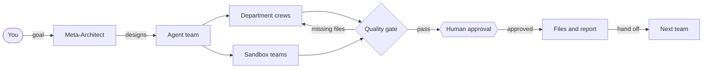
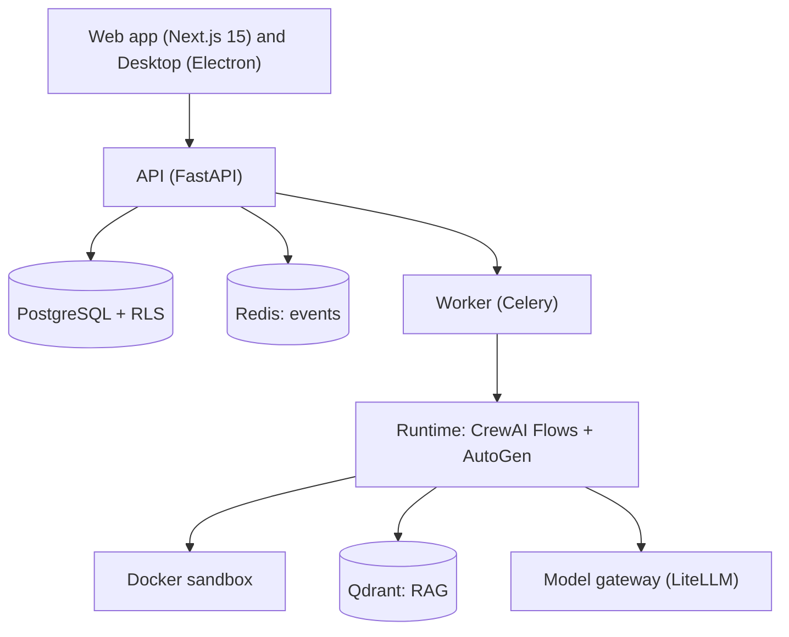

<p align="center">
  
</p>

<h3 align="center">A governed team of AI agents in your own sandbox.<br>Describe a goal. Agents plan, code and produce files. You approve the risky steps.</h3>

<p align="center">
  <b>English</b> · <a href="README.vi.md">Tiếng Việt</a>
</p>

<p align="center">
  <a href="https://github.com/khangkaka066/Nexus-Agent/actions/workflows/ci.yml"></a>
  <a href="LICENSE"></a>
  <a href="https://github.com/khangkaka066/Nexus-Agent/stargazers"></a>
  <a href="https://github.com/khangkaka066/Nexus-Agent/forks"></a>
  <a href="https://github.com/khangkaka066/Nexus-Agent/issues"></a>
  <a href="CONTRIBUTING.md"></a>
</p>

<p align="center">
  
  
  
  
  
  
</p>

<p align="center">
  <a href="#-quick-start">Quick start</a> ·
  <a href="#-see-it">Screenshots</a> ·
  <a href="#-what-you-get">Features</a> ·
  <a href="#-agent-studios">Agent studios</a> ·
  <a href="#-connect-a-model">Models</a> ·
  <a href="#-roadmap-and-honest-limits">Roadmap</a> ·
  <a href="CONTRIBUTING.md">Contribute</a>
</p>

---

## Why NexusAgent

Most multi-agent projects are libraries: you write the orchestration, the sandbox, the review step and the UI yourself. NexusAgent is the finished product built on top of them. It is a self-hosted web and desktop app where you type a goal, an AI architect designs a whole **team** of agents for it, the team runs inside an isolated Docker computer, and a human approves the sensitive steps.

- **Team, not chatbot.** A request becomes a structured team: directors, department leads and specialists, with a quality gate that sends missing work back to the right department.
- **Safe by design.** Code runs in a locked-down container. Sensitive actions stop at an approval card. Every decision is written to an audit log.
- **Honest results.** A team that claims a file it never wrote fails with a clear message (media is never invented) instead of finishing as if it had delivered.
- **Bring any model.** Use your ChatGPT, Claude, Gemini or GitHub Copilot plan, an API key, any OpenAI-compatible gateway, or a local Ollama model.
- **Yours.** Self-hosted, MIT licensed, no telemetry leaves your machine.

---

## 🖼️ See it

<p align="center">
  
</p>
<p align="center"><sub>A tour of the real interface (frames from the screenshots below).</sub></p>

<table>
  <tr>
    <td width="50%"><br><sub><b>One prompt.</b> Describe the result; pick a model and a team size.</sub></td>
    <td width="50%"><br><sub><b>Results next to the chat.</b> Preview, download, and hand the files to the next team.</sub></td>
  </tr>
  <tr>
    <td><br><sub><b>Code as a diff.</b> Accept or reject a file into your project folder.</sub></td>
    <td><br><sub><b>The team on a canvas.</b> Directors, departments, sandboxes, quality gate and sign-off.</sub></td>
  </tr>
  <tr>
    <td><br><sub><b>Switch model on the fly.</b> Connected models, well-known ones, or any model id.</sub></td>
    <td><br><sub><b>Use the plan you already pay for.</b> Claude, ChatGPT, Copilot, Gemini or an API key.</sub></td>
  </tr>
</table>

---

## ⚡ Quick start

You need Docker Compose, and either an AI subscription you already use (ChatGPT, Claude, Gemini, GitHub Copilot) or an API key.

```bash
git clone https://github.com/khangkaka066/Nexus-Agent.git && cd Nexus-Agent
cp .env.example .env
openssl rand -hex 32      # paste into: NEXUS_POSTGRES_PASSWORD, NEXUS_RUNTIME_DB_PASSWORD,
                          #             NEXUS_REDIS_PASSWORD, NEXUS_SECRET_KEY, NEXUS_API_KEY_PEPPER
openssl rand -base64 32   # paste into: NEXUS_CREDENTIAL_ENCRYPTION_KEY_BASE64
docker compose up -d --build
```

Open **http://localhost:3000**. There is no sign-up in local mode: a *Local Workspace* is created for you. Then:

1. **AI Settings → Models & keys:** connect a model (see [Connect a model](#-connect-a-model)).
2. Type what you want on the **Work** screen and press Enter.
3. Open the files the team produced, download them, or hand them to another team.

On Linux set `NEXUS_DOCKER_GID` to the group of `/var/run/docker.sock` and run `sudo chown -R 10001 data/artifacts` so the containers can write results. The API and `packages/` are mounted with `--reload`; after changing runtime code run `docker compose restart worker`, which does not reload by itself.

> **Local mode** (`NEXUS_LOCAL_MODE=true`, the default in `docker-compose.yml`) gives anyone who can reach the API an owner session. Use it on a personal machine only; the web and API ports are bound to `127.0.0.1`. On a shared or public server set `NEXUS_LOCAL_MODE=false` to require accounts.

---

## ✨ What you get

| | Feature | What it does |
|---|---|---|
| 🧠 | **AI Meta-Architect** | Turns a sentence into a compilable team: agents, tasks, tools, knowledge and approval gates. |
| 🏢 | **Hierarchical teams** | Directors, department leads and specialists work in parallel waves with artifact contracts and a rework loop. |
| 💻 | **Code sandbox** | Coder and reviewer agents run code in Docker (no network, dropped capabilities, resource limits) until it verifies. |
| ✅ | **Human approval** | Sensitive steps pause on an *Allow once / Always allow / Deny* card; every decision is audited. |
| 🗂️ | **Task history** | Every task and its conversation is saved; reopen it, delete it, or retry it. |
| 🩺 | **Readable failures** | The failure card names the department and agent that stopped and the sanitised error. Retry only the failed step (finished departments are kept) or the whole team. |
| 🔗 | **Team-to-team handoff** | Attach files from an earlier task with `@`, or press *Hand off* to start a marketing or analytics team from the results. |
| 🔌 | **Model freedom** | Subscription connectors, API keys, OpenRouter, Groq, Mistral, DeepSeek, Ollama, LM Studio, vLLM and any OpenAI-compatible gateway; switch model per task. |
| 📚 | **RAG + MCP** | Upload documents into a knowledge base (Qdrant), or connect MCP servers and OpenAPI tools. |
| 🔁 | **Time travel** | Rewind to any checkpoint, edit state, resume, or fork two branches and compare them. |
| 🧬 | **Learning & evolution** | Agents share vetted lessons under a scope firewall; teams diagnose bottlenecks and propose new generations, with rollback. |
| 💸 | **FinOps** | Per-model cost tracking, plan usage recorded at $0, and cheaper-model suggestions once quality is verified. |
| 🛡️ | **Multi-tenant security** | PostgreSQL row-level security on every table, RBAC, scoped API keys, encrypted credentials. |
| 🌐 | **English and Vietnamese** | Switch the interface language at any time. |

---

## 🎬 Agent studios

Ask for a product and NexusAgent builds a whole studio. Pick the size: *compact*, *by department* (~19 agents) or *full studio*.

| Studio | Agents | Produces |
|---|---:|---|
| **Feature Film & Series Production** | 50 | Screenplay, storyboard and previs, design and casting, camera, sound, VFX, budget and schedule, animatic, distribution plan. |
| **Full Game Development** | 49 | Design docs, art direction, code, build checks, playable preview. |
| **Marketing & Social Publishing** | 41 | Strategy, copy, per-channel packages for TikTok, YouTube and Facebook, content calendar, KPI tracker, launch checklist. |
| **Analytics & Optimization** | 34 | Measurement plan, KPI baseline from the data you attach, experiment plan, forecast, HTML report. |
| **Full-Stack SaaS & AI Software Factory** | 32 | Architecture, backend and frontend code, tests, security review, release notes. |
| **Cinematic Video & Documentary** | 26 | Research, script, storyboard, voice and sound plan, subtitles, contact sheet. |

Plus four small templates: Data Science & Financial Analyst, Software QA & Security Auditor, Market Research & Content Engine, and an Executive Inbox & Operations teammate.

---

## 🏗️ How it works





The runtime is assembled from plugins: connections, model access, checkpoints, tools, and the sandbox supervisor with its Docker provider are independent plugins mounted by a small kernel (`python -m nexus_plugins dump-config` prints what a process boots). See [AGENTS.md](AGENTS.md) for the rules.

| Path | Role |
|---|---|
| `apps/web` | Next.js interface |
| `apps/api` | FastAPI control plane, auth, billing, workers |
| `apps/desktop` | Electron shell with local folder mounting |
| `packages/agent-runtime` | Flow compiler, crews, AutoGen bridge, time travel, consensus, plugin kernel |
| `packages/learning-transfer` | Knowledge capsules, scope firewall, self-healing prompts |
| `packages/model-gateway` | Providers, subscription connectors, pricing, FinOps |
| `packages/computer-sandbox` | Docker and cloud sandbox providers |
| `packages/rag-engine`, `mcp-hub`, `builtin-tools` | Retrieval, MCP and OpenAPI tools, built-in tools |
| `packages/core-schema` | Shared schemas and the studio blueprints |

---

## 🔌 Connect a model

Open **AI Settings → Models & keys**.

| Source | How |
|---|---|
| **GitHub Copilot** | *Sign in with GitHub* and enter the 8-character code. |
| **ChatGPT Plus / Pro / Team** | `codex login`, copy `~/.codex/auth.json` into `data/subscriptions/codex/` (or paste it), and give the URL of your subscription bridge. |
| **Claude Pro / Max** | `claude setup-token` and paste the token, or copy `~/.claude/.credentials.json` into `data/subscriptions/claude/`. |
| **Gemini Advanced / Code Assist** | Copy `~/.gemini/oauth_creds.json` into `data/subscriptions/gemini/`, or paste a bridge token. |
| **API key or gateway** | **Nexus Harness**: enter the API URL and key of any OpenAI-compatible provider; models are discovered automatically. OpenAI, Anthropic, Gemini, DeepSeek and Ollama have their own cards. |

Use the model selector in the header (or the small pill in the prompt bar) to switch model per task, including any model id you type. Plan usage is recorded at $0 per token; no price table is needed.

> Plan tokens work only on endpoints that understand them (for example a bridge such as CLIProxyAPI), and providers may limit using plan tokens outside their own apps. Check the terms of your plan.

---

## 🖥️ Desktop app

[apps/desktop](apps/desktop/README.md) is an Electron shell: open a real project folder (`⌘/Ctrl+O`), review changes as diffs, accept them into your files, a global shortcut (`⌘/Ctrl+Shift+Space`) for quick tasks, and system notifications. `pnpm --filter @nexus/desktop dev` runs it and `pnpm --filter @nexus/desktop build` packages it. The macOS `.dmg` build is verified; Windows and Linux targets are configured but not yet tested.

---

## ⚙️ Configuration

| Group | Variables |
|---|---|
| Security | `NEXUS_SECRET_KEY`, `NEXUS_API_KEY_PEPPER`, `NEXUS_CREDENTIAL_ENCRYPTION_KEY_BASE64` |
| Models | `NEXUS_*_API_KEY` (optional server keys), `NEXUS_MODEL_RATES_JSON` (optional cost estimates) |
| Plans | `NEXUS_CODEX_HOME`, `NEXUS_CLAUDE_HOME`, `NEXUS_GEMINI_HOME`, `NEXUS_COPILOT_HOME` |
| Plugins | `NEXUS_PLUGINS_FILE`, `NEXUS_PLUGIN_PATCHES` |
| Access | `NEXUS_LOCAL_MODE`, `NEXUS_PUBLIC_SIGNUP_ENABLED`, `NEXUS_REGISTRATION_TOKEN`, `NEXUS_CORS_ORIGINS` |
| Sandbox | `NEXUS_COMPUTER_ROOT`, `NEXUS_DOCKER_GID` |

Everything is listed in [.env.example](.env.example). Call the API with a scoped key: `curl -H "Authorization: Bearer nx-sk-<KEY>" http://localhost:8000/api/v1/workflows`.

---

## 🧪 Development and tests

```bash
pytest && mypy packages/ apps/api/          # backend: 180+ tests, strict typing
pnpm lint && pnpm check && pnpm test        # frontend
python3 scripts/smoke_test.py               # full stack (needs a model key)
```

CI runs the same commands plus licence and branding checks on every push. Read [CONTRIBUTING.md](CONTRIBUTING.md) before opening a pull request.

---

## 🧭 Roadmap and honest limits

- **Posting to TikTok, Facebook and YouTube is not wired yet.** The marketing and film teams write publish-ready packages and checklists and stop at your approval; channel cards store a token and check connectivity only.
- **Video generation** depends on your provider offering a video API. Agents describe, plan and assemble media; they do not invent files.
- The interface has a single local workspace for now; the multi-workspace switcher is planned (the backend already isolates workspaces).
- Agents can still misjudge their own work. Failed claims are caught and reported, and every run can be retried, but review important output yourself.
- Planned: node handlers as plugins, per-workspace plugin configuration, Windows and Linux desktop verification.

Ideas and bug reports are welcome in [Issues](https://github.com/khangkaka066/Nexus-Agent/issues).

---

## ⭐ Support the project

If NexusAgent saves you time, a star helps other people find it, and sharing a screenshot of a team you built helps even more.

<a href="https://star-history.com/#khangkaka066/Nexus-Agent&Date">
  
</a>

## 🔒 Security and license

- Isolation by tenant and workspace in PostgreSQL, Qdrant, Redis and the sandbox. Report vulnerabilities privately: see [SECURITY.md](SECURITY.md).
- No telemetry is sent anywhere.
- Only permissively licensed dependencies are used (checked in CI); see [THIRD_PARTY_NOTICES.md](THIRD_PARTY_NOTICES.md).
- Released under the [MIT License](LICENSE).

<sub>**Topics:** multi-agent, ai-agents, agent-orchestration, llm, workflow-automation, crewai, autogen, mcp, rag, human-in-the-loop, docker-sandbox, self-hosted, fastapi, nextjs, multi-tenant, ai-workflow-builder.</sub>
