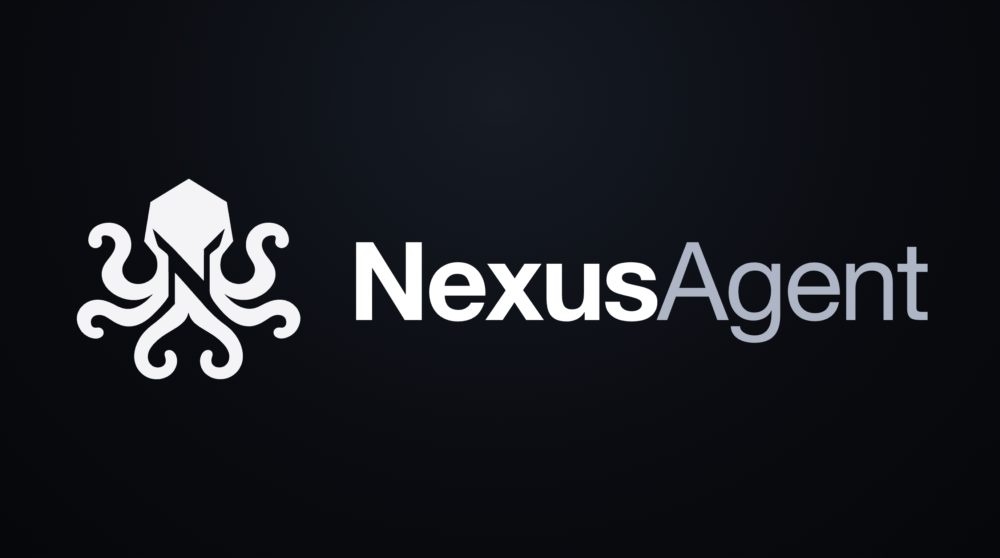
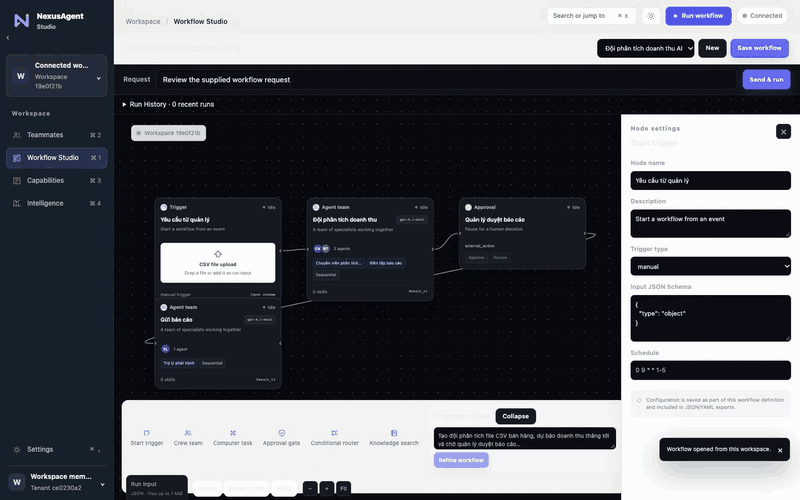
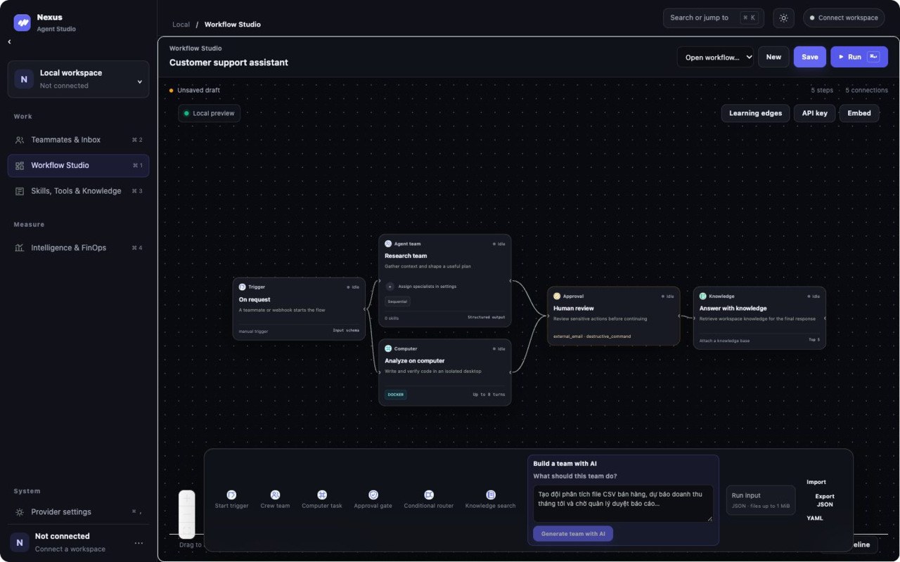
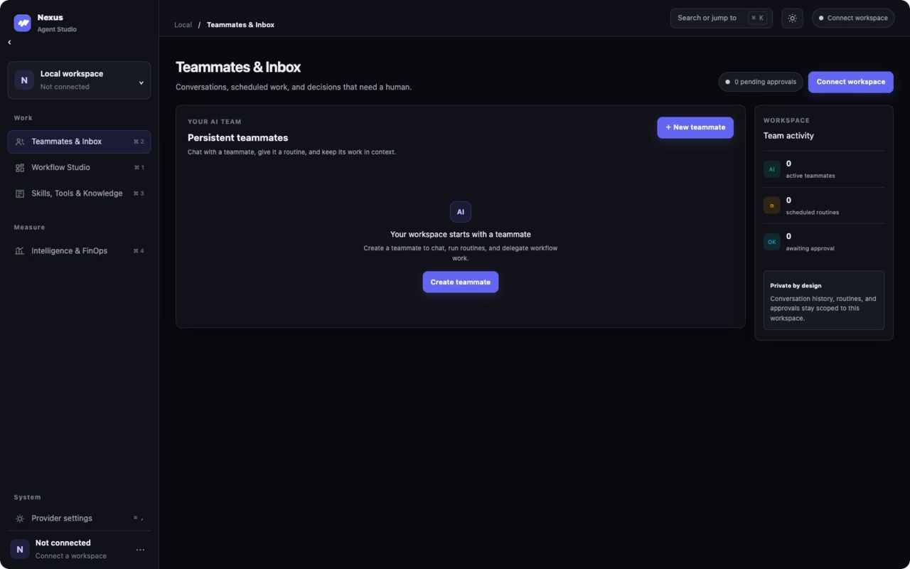
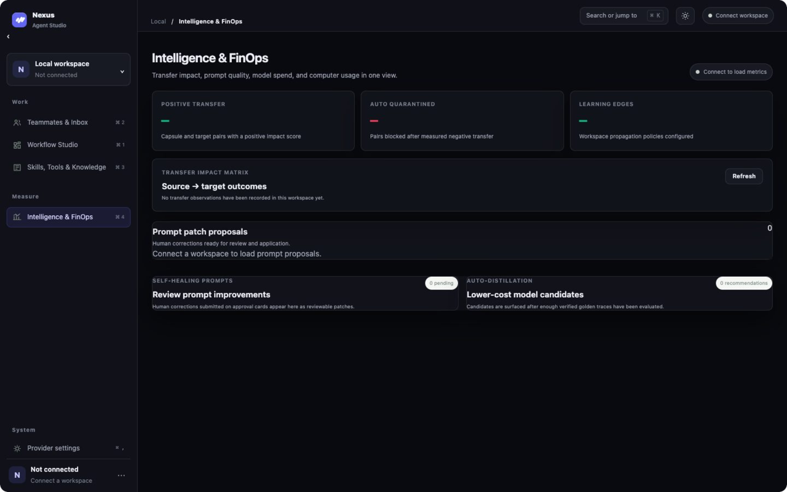

<p align="center">
  
</p>

<p align="center"><b>Dựng đội AI bằng kéo-thả. Người duyệt ở bước quan trọng.</b></p>

<p align="center">
  <a href="#-demo">Demo</a> ·
  <a href="#-giao-diện">Giao diện</a> ·
  <a href="#-tính-năng">Tính năng</a> ·
  <a href="#-cài-đặt-nhanh">Cài đặt</a> ·
  <a href="#-sử-dụng">Sử dụng</a> ·
  <a href="https://github.com/khangkaka066/Nexus-Agent/issues">Issues</a>
</p>

<p align="center">
  <a href="https://github.com/khangkaka066/Nexus-Agent/stargazers"></a>
  <a href="https://github.com/khangkaka066/Nexus-Agent/forks"></a>
  <a href="https://github.com/khangkaka066/Nexus-Agent/issues"></a>
  <a href="https://github.com/khangkaka066/Nexus-Agent/pulls"></a>
  <a href="LICENSE"></a>
</p>

<p align="center">
  
  
  
  
</p>

---

## 🎬 Demo

<p align="center">

</p>

<p align="center"><sub>Bản quay thật: gửi yêu cầu → đội agent phân tích và viết báo cáo → dừng chờ quản lý duyệt → <b>Allow once</b> → hoàn tất (2.536 token, ~$0,002).</sub></p>

---

## 🖼️ Giao diện

### 1 · Workflow Studio — dựng quy trình
Kéo-thả node hoặc mô tả bằng lời để AI dựng cả đội agent.
<p align="center"></p>

### 2 · Teammates — đồng đội AI
Có trí nhớ, routine theo lịch và thẻ phê duyệt.
<p align="center"></p>

### 3 · Intelligence — đo lường & tiết kiệm
Tác động tri thức chuyển giao, bản vá prompt, gợi ý hạ chi phí model.
<p align="center"></p>

---

## ✨ Tính năng

| | Tính năng | Làm được gì |
|---|---|---|
| 🧩 | **Workflow Studio** | Kéo-thả node trên canvas, xuất bản thành REST API hoặc WebApp nhúng |
| 🤝 | **Đa-agent** | Nhiều agent cộng tác theo vai trò, mỗi bước có checkpoint để dừng/chạy tiếp |
| 💻 | **Code Sandbox** | Agent viết code, chạy trong container cô lập, tự sửa lỗi đến khi chạy sạch |
| 🧑‍💼 | **Đồng đội AI** | Bot có trí nhớ, công cụ, routine theo lịch và chat bằng giọng nói |
| 🖥️ | **Computer Sandbox** | Terminal, file, trình duyệt trong Docker đã siết bảo mật |
| ✅ | **Phê duyệt** | Dừng ở bước nhạy cảm, hiện thẻ `Allow once` / `Always allow` / `Deny`, ghi audit log |
| 📚 | **RAG** | Nạp PDF/DOCX/MD/CSV, tìm kiếm lai, tách biệt dữ liệu từng tenant |
| 🏢 | **Đa-tenant** | Cô lập bằng Row-Level Security, RBAC, API key, BYOK, tính chi phí |

### 🚀 6 điểm khác biệt

| # | Tên | Một câu |
|---|-----|---------|
| 1 | Learning Transfer | Agent học từ nhau, có tường lửa phạm vi và tự thu hồi tri thức gây hại |
| 2 | Self-Healing Prompt | Góp ý khi duyệt → tự đề xuất bản vá prompt dạng git-diff |
| 3 | Time-Travel | Quay lại bất kỳ checkpoint, sửa và chạy lại, hoặc chạy A/B hai nhánh |
| 4 | FinOps | Gợi ý hạ sang model rẻ hơn khi chất lượng tương đương ≥ 95% |
| 5 | Swarm Consensus | Nhiều model phản biện chéo, độ tin cậy thấp thì chuyển cho người duyệt |
| 6 | Meta-Architect | Mô tả bằng lời → sinh workflow hoàn chỉnh |
| 7 | Team Evolution | Đội agent tự chẩn đoán điểm nghẽn, thêm/tách/gộp/cắt thành viên, chấm điểm từng thế hệ và tự quay lui khi tệ hơn |

---

## 🏗️ Kiến trúc

```text
 Web (Next.js)  ──►  API (FastAPI)  ──►  Worker (Celery)
                        │                    │
         ┌──────────────┼────────────────────┤
         ▼              ▼                    ▼
    PostgreSQL        Redis             Sandbox (Docker)
    (RLS)                               Qdrant (RAG)
```

| Thư mục | Vai trò |
|---------|---------|
| `apps/web` | Giao diện |
| `apps/api` | API, xác thực, thanh toán, worker |
| `packages/agent-runtime` | Chạy workflow, time-travel, consensus |
| `packages/learning-transfer` | Học chuyển giao, self-healing |
| `packages/model-gateway` | Định tuyến model, chi phí, FinOps |
| `packages/computer-sandbox` | Sandbox Docker |
| `packages/rag-engine`, `mcp-hub` | RAG và công cụ MCP/OpenAPI |

---

## ⚡ Cài đặt nhanh

**Cần:** Docker Compose và một gói AI đang dùng (ChatGPT, Claude, Gemini, GitHub Copilot) *hoặc* một API key.

```bash
git clone https://github.com/khangkaka066/Nexus-Agent.git && cd Nexus-Agent
cp .env.example .env
openssl rand -hex 32      # dán vào: NEXUS_POSTGRES_PASSWORD, NEXUS_RUNTIME_DB_PASSWORD,
                          #          NEXUS_REDIS_PASSWORD, NEXUS_SECRET_KEY, NEXUS_API_KEY_PEPPER
openssl rand -base64 32   # dán vào: NEXUS_CREDENTIAL_ENCRYPTION_KEY_BASE64
docker compose up -d --build
```

Mở **http://localhost:3000** (API ở `:8000`). Linux: đặt `NEXUS_DOCKER_GID` theo group của `/var/run/docker.sock`, và `sudo chown -R 10001 data/artifacts` để container ghi được kết quả.

Mã nguồn `apps/api` và `packages/` được mount vào container với `--reload`, nên sửa code là API tự nạp lại (worker cần `docker compose restart worker`). Kết quả chạy workflow nằm ở `./data/artifacts/`.

---

## 📖 Sử dụng

```text
1 Đăng ký ─► 2 Thêm key model ─► 3 Tạo workflow ─► 4 Chạy & duyệt ─► 5 Publish
```

1. **Mở ứng dụng:** vào http://localhost:3000, không cần đăng ký. Workspace *Local Workspace* được tạo sẵn.
2. **Kết nối model:** vào **Cài đặt AI** (xem mục [Kết nối gói đăng ký](#-kết-nối-gói-đăng-ký-ai)). Không cần bảng giá: model chưa có giá chạy ở mức $0 (`SUBSCRIPTION_INCLUDED`).
3. **Tạo workflow:** vào **Studio**, chọn template hoặc nhờ **Canvas Copilot**, ví dụ *"Nghiên cứu thị trường, có bước duyệt trước khi gửi báo cáo"*.
4. **Chạy & duyệt:** bấm **Run**, theo dõi **Inspector** (suy nghĩ agent, terminal, màn hình), xử lý Approval Card.
5. **Publish:** lấy REST endpoint hoặc mã nhúng.

**Thêm đồng đội AI:** **Teammates** → tạo bot → gắn công cụ → viết routine Markdown (*"8h sáng mỗi ngày, tóm tắt tin ngành"*).
**Thêm tri thức:** tải tài liệu vào Knowledge Base rồi gắn vào node RAG hoặc bot.

**Gọi API:**

```bash
curl -H "Authorization: Bearer nx-sk-<API_KEY>" http://localhost:8000/v1/workflows
```

---

## 🖥️ Giao diện và ứng dụng Desktop

Mở **http://localhost:3000** là dùng được ngay, không cần đăng nhập (chế độ local, xem lưu ý bên dưới). Thanh bên chỉ có **Làm việc** và **Cài đặt AI**, kèm cây tệp của các tác vụ:

| Mục | Làm gì |
|-----|--------|
| **Làm việc** | Một ô nhập trung tâm: *"Bạn muốn đội Agent làm gì hôm nay?"*. Gõ yêu cầu, Enter: đội Agent được thiết kế và chạy ngay. Màn hình tách đôi: cuộc trò chuyện bên trái, sản phẩm bên phải (diff mã, ảnh, báo cáo, **video và âm thanh phát ngay tại chỗ**, nút **Tải xuống** cho mọi file), terminal thu gọn bên dưới. Nút **Xem sơ đồ Agent Canvas** (⌘/Ctrl+\) mở đồ thị để chỉnh đội. |
| **Cây tác vụ (thanh bên)** | Mọi tác vụ (đang chạy, chờ duyệt, thất bại, hoàn tất) với chấm trạng thái; file của từng tác vụ nằm bên dưới. Bấm một tác vụ để mở lại **cả cuộc hội thoại** (được lưu trong Postgres), bấm một file để xem ở màn hình Làm việc; nút × xóa tác vụ cùng hội thoại, kết quả chạy và file của nó. |
| **Khi tác vụ thất bại** | Thẻ lỗi cho biết phòng ban và **agent** nào dừng (đội sandbox ghi "Coder + Reviewer"), lỗi gì (đã lọc khóa và đường dẫn máy chủ) và chi tiết kỹ thuật; **Chạy lại bước lỗi** tiếp tục từ checkpoint cuối, các phòng ban đã xong được giữ nguyên; **Chạy lại cả đội** bắt đầu lại từ đầu. |
| **Chuyển kết quả cho đội khác** | Cùng một workspace: tác vụ vừa xong tự đính kèm file của nó cho tin nhắn tiếp theo (gỡ được bằng ×); gõ `@` hoặc bấm *Đính kèm* để chọn file của bất kỳ tác vụ nào; thẻ tác vụ hoàn tất có nút **Marketing & đăng mạng xã hội**, **Phân tích & tối ưu** và **Dùng kết quả cho tác vụ mới**. File được sao chép sang lần chạy mới, nên xóa tác vụ cũ không làm hỏng đội sau. |
| **Cài đặt AI → Mô hình & khóa** | 3 mục: gói đăng ký sẵn có, **Nexus Harness** (nhà cung cấp API Key bên thứ 3: nhập URL và khóa), mô hình khác hoặc chạy máy cá nhân. *Chế độ Chuyên gia* mở bảng số liệu học tập và chi phí, đồng đội AI, tài liệu đã tải lên và toàn bộ nhà cung cấp. |
| **Cài đặt AI → Tích hợp** | Kỹ năng và kết nối MCP. Mục TikTok, Facebook, YouTube chỉ hiện khi workspace có một đội dùng chúng (ví dụ xưởng phim). |

Góc trên bên phải có **bộ chọn mô hình** (bấm để đổi mô hình cho các tác vụ mới: `gpt-4.1-mini`, `gpt-4o`, `claude-sonnet-4-6`, `gemini-2.5-flash`, `deepseek-chat` hay mô hình Ollama phát hiện trên máy, tùy khóa bạn đã kết nối); cùng bộ chọn thu gọn nằm trong ô nhập. Cạnh đó là nút `?` mở bảng phím tắt (có thể đổi phím).

> **Chế độ local** (`NEXUS_LOCAL_MODE=true`, mặc định trong `docker-compose.yml`) cấp phiên chủ sở hữu cho bất kỳ ai truy cập được API. Chỉ dùng trên máy cá nhân; cổng API và web đã bind vào `127.0.0.1`. Trên máy chủ dùng chung hoặc công khai, đặt `NEXUS_LOCAL_MODE=false` để quay lại đăng nhập tài khoản.

Ứng dụng desktop (Electron) nằm ở [apps/desktop](apps/desktop/README.md): mở thư mục dự án thật (`⌘/Ctrl+O`), phím tắt toàn cục `⌘/Ctrl+Shift+Space` để giao việc nhanh, thông báo hệ điều hành. Chạy: `pnpm --filter @nexus/desktop dev`; đóng gói: `pnpm --filter @nexus/desktop build` (`.dmg` / `.exe` / `.AppImage`).

---

## 🔌 Kết nối gói đăng ký AI

**Settings → Subscription Plans & AI Providers** có hai chế độ: **Connect Subscription Plan (OAuth / CLI Token)** và **Connect Gateway / API Key**. Lượt dùng thuộc gói được ghi `billing_mode = SUBSCRIPTION_INCLUDED`, chi phí $0 trên mỗi token.

| Gói | Cách kết nối |
|-----|--------------|
| **GitHub Copilot** | Bấm *Sign in with GitHub*, nhập mã 8 ký tự tại github.com/login/device. Dùng GPT, Claude, Gemini có trong gói Copilot. |
| **ChatGPT Plus / Pro / Team** | `codex login`, chép `~/.codex/auth.json` vào `data/subscriptions/codex/` (hoặc dán nội dung) và nhập URL cầu nối gói đăng ký. |
| **Claude Pro / Max** | `claude setup-token` rồi dán token, hoặc chép `~/.claude/.credentials.json` vào `data/subscriptions/claude/`. |
| **Gemini Advanced / Code Assist** | Chép `~/.gemini/oauth_creds.json` vào `data/subscriptions/gemini/`, hoặc dán token cầu nối. |
| **Nhà cung cấp API Key bên thứ 3, OpenRouter, CLIProxyAPI** | Cài đặt AI → **Nexus Harness**: nhập URL API và khóa, mô hình được lấy tự động. OpenRouter, CLIProxyAPI nằm trong Chế độ Chuyên gia. |

Mỗi thẻ có nút **Verify Subscription & Test Model**: gọi thật 1 token qua đúng đường mà workflow dùng. Chi tiết thư mục mount: [data/subscriptions/README.md](data/subscriptions/README.md).

> Token gói ChatGPT/Claude/Gemini chỉ chạy được trên endpoint hiểu chúng (ví dụ cầu nối như CLIProxyAPI); nhà cung cấp có thể giới hạn việc dùng token gói ngoài app chính chủ. Hãy kiểm tra điều khoản của gói bạn.

---

## 🎥 Quay GIF demo bằng Recordly

[Recordly](https://github.com/webadderallorg/recordly) (miễn phí, macOS/Windows/Linux) quay màn hình và tự thêm zoom, nền đẹp. Chỉ là công cụ ngoài, không phải phụ thuộc của dự án.

1. Cài Recordly từ trang Releases, chạy `docker compose up --build`.
2. Chọn cửa sổ trình duyệt ở http://localhost:3000 → **Record**.
3. Quay: Copilot tạo workflow → Run → Inspector → duyệt Approval Card (~60–90 giây).
4. Chỉnh trong Recordly → **Export GIF** → lưu đè `docs/media/nexus-run.gif`.

---

## ⚙️ Cấu hình chính

| Nhóm | Biến |
|------|------|
| Bảo mật | `NEXUS_SECRET_KEY`, `NEXUS_API_KEY_PEPPER`, `NEXUS_CREDENTIAL_ENCRYPTION_KEY_BASE64` |
| Model | `NEXUS_*_API_KEY` (tuỳ chọn), `NEXUS_MODEL_RATES_JSON` (tuỳ chọn, chỉ để ước tính chi phí) |
| Gói đăng ký | `NEXUS_CODEX_HOME`, `NEXUS_CLAUDE_HOME`, `NEXUS_GEMINI_HOME`, `NEXUS_COPILOT_HOME` |
| Giọng nói | `NEXUS_STT_API_KEY`, `NEXUS_TTS_API_KEY` |
| Sandbox | `NEXUS_COMPUTER_ROOT`, `NEXUS_DOCKER_GID` |
| Đăng ký | `NEXUS_PUBLIC_SIGNUP_ENABLED`, `NEXUS_REGISTRATION_TOKEN` |

Danh sách đầy đủ: [.env.example](.env.example). Sandbox đi kèm chạy headless: terminal và chạy code hoạt động, còn màn hình trực tiếp cần thêm browser driver.

---

## 🧪 Kiểm thử

```bash
pytest && mypy --strict packages/ apps/api/
npx --yes pnpm@9.15.4 lint && npx --yes pnpm@9.15.4 check && npx --yes pnpm@9.15.4 test
```

Test E2E (`python3 scripts/smoke_test.py`) cần một API key cho model; không cần bảng giá.

---

## 🔒 Bảo mật & giấy phép

- Cô lập theo tenant/workspace ở Postgres, Qdrant, Redis và sandbox.
- Không gửi telemetry ra ngoài.
- Chỉ dùng dependency giấy phép thương mại an toàn (kiểm bằng `scripts/check-*-licenses`). Xem [THIRD_PARTY_NOTICES.md](THIRD_PARTY_NOTICES.md).
- Giấy phép dự án: [MIT](LICENSE).
