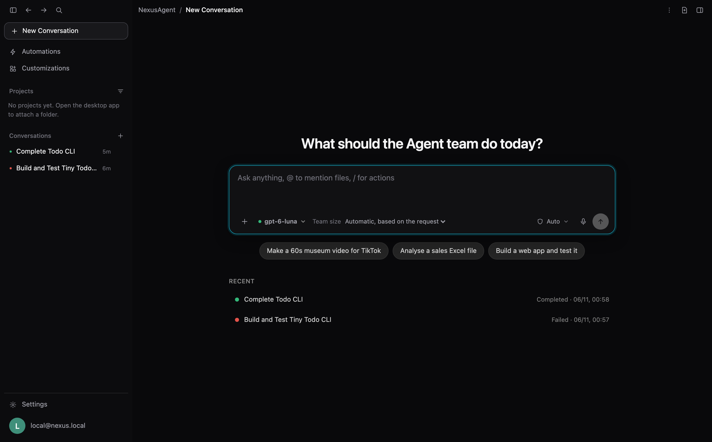
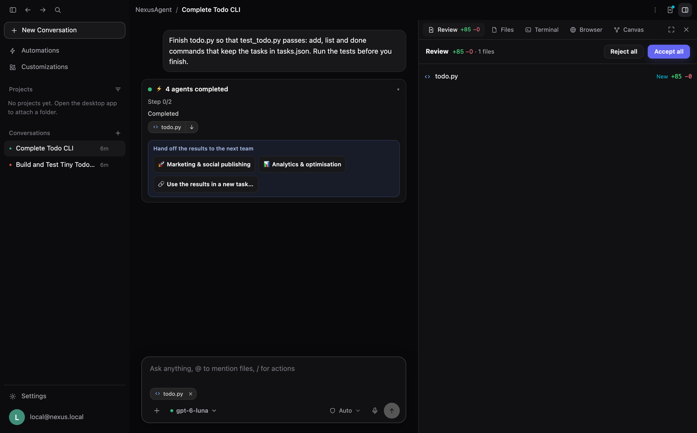
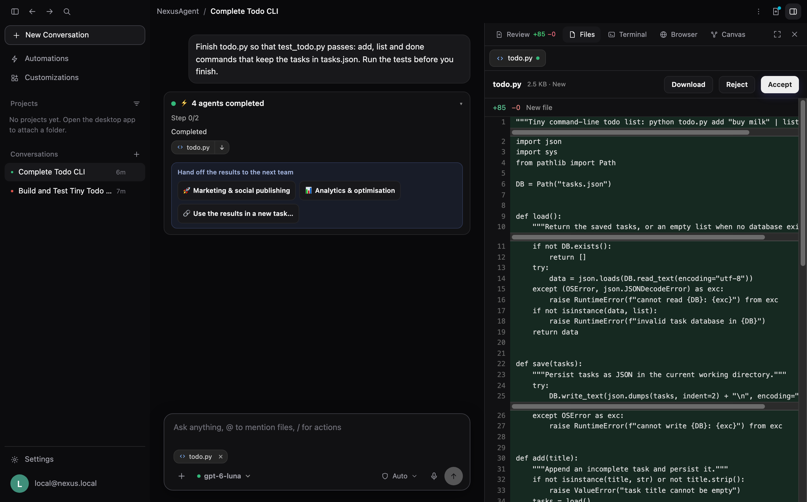
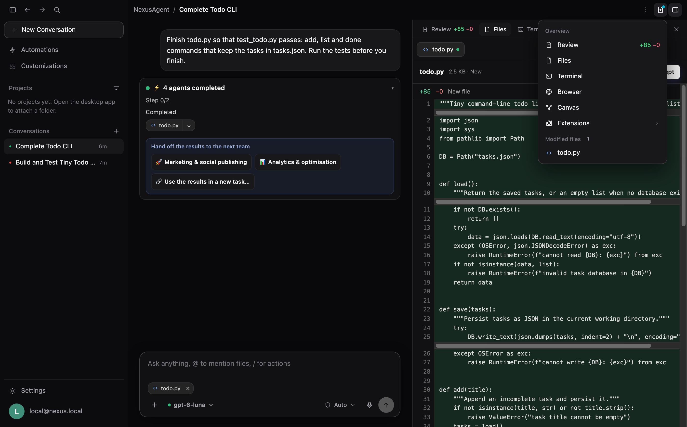
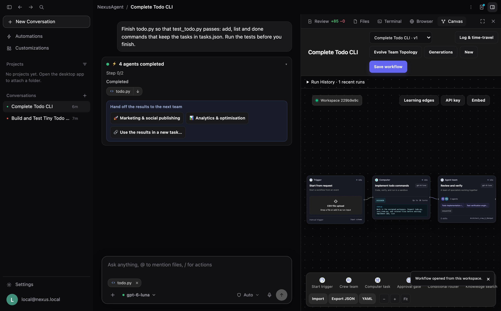
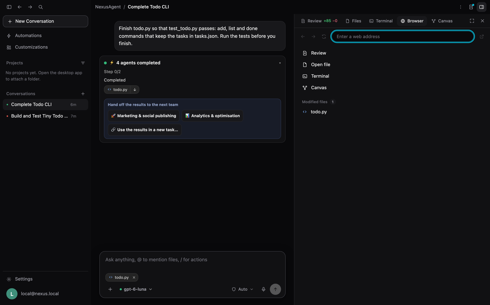
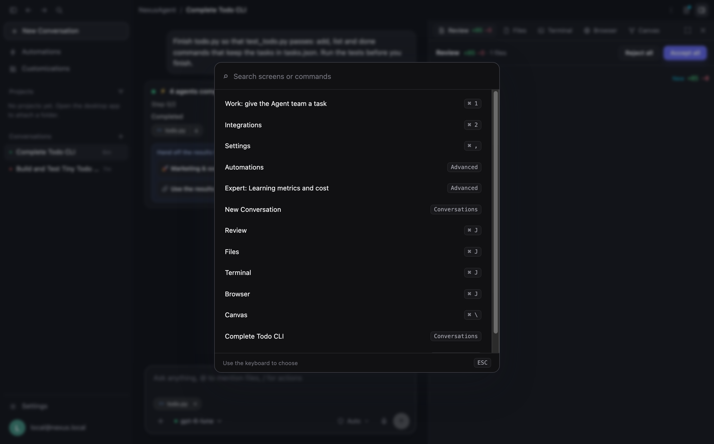
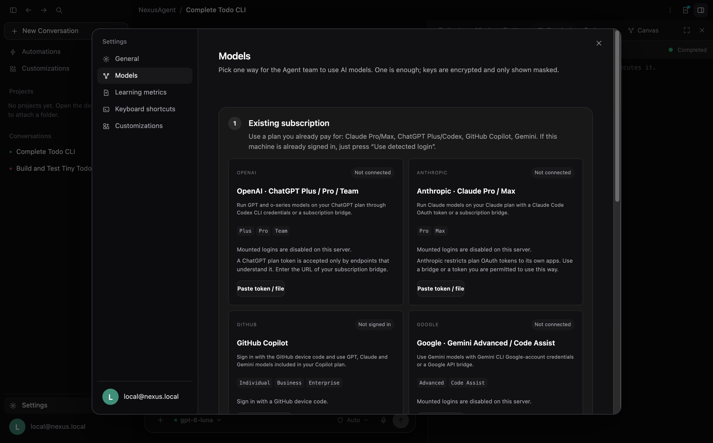
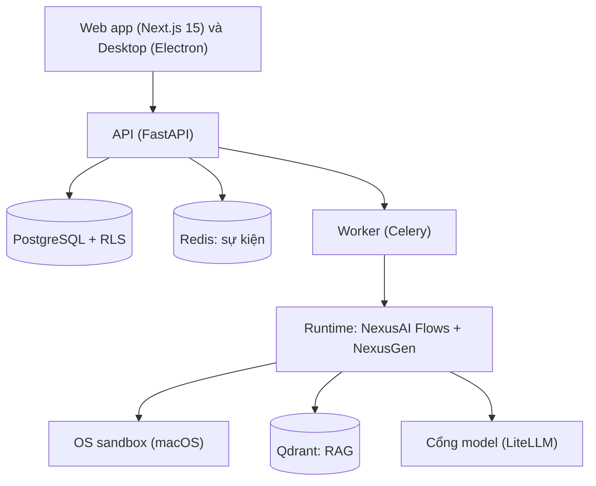

<p align="center">
  
</p>

<h3 align="center">Một đội AI có kiểm soát, chạy trong sandbox của chính bạn.<br>Nêu mục tiêu. Các agent lập kế hoạch, viết code và tạo file. Bạn duyệt những bước rủi ro.</h3>

<p align="center">
  <a href="README.md">English</a> · <b>Tiếng Việt</b>
</p>

<p align="center">
  <a href="https://github.com/khangkaka066/Nexus-Agent/actions/workflows/ci.yml"></a>
  <a href="LICENSE"></a>
  <a href="https://github.com/khangkaka066/Nexus-Agent/stargazers"></a>
  <a href="https://github.com/khangkaka066/Nexus-Agent/forks"></a>
  <a href="https://github.com/khangkaka066/Nexus-Agent/issues"></a>
  <a href="CONTRIBUTING.md"></a>
</p>

<p align="center">
  
  
  
  
  
  
</p>

<p align="center">
  <a href="#-cài-đặt">Cài đặt</a> ·
  <a href="#-hình-ảnh">Hình ảnh</a> ·
  <a href="#-giao-diện">Giao diện</a> ·
  <a href="#-tính-năng">Tính năng</a> ·
  <a href="#-các-studio-agent">Studio agent</a> ·
  <a href="#-kết-nối-mô-hình">Mô hình</a> ·
  <a href="#-lộ-trình-và-giới-hạn-thực-tế">Lộ trình</a> ·
  <a href="CONTRIBUTING.md">Đóng góp</a>
</p>

---

## Vì sao có NexusAgent

Phần lớn dự án đa-agent chỉ là thư viện: bạn tự viết điều phối, sandbox, bước duyệt và giao diện. NexusAgent là sản phẩm hoàn chỉnh xây trên chúng. Đây là ứng dụng web và desktop tự lưu trữ: bạn gõ một mục tiêu, một AI kiến trúc sư thiết kế cả **đội** agent cho nó, đội chạy trong một sandbox cô lập, và con người duyệt những bước nhạy cảm.

- **Một đội, không phải chatbot.** Yêu cầu thành đội có cấu trúc: giám đốc, trưởng phòng và chuyên viên, kèm cổng chất lượng trả phần thiếu về đúng phòng ban.
- **Chạy trên máy Mac không cần Docker.** Ứng dụng desktop tự mang theo database, hàng đợi, vector store, API, Node, git và ffmpeg; lệnh của agent chạy trong sandbox của hệ điều hành. Bản máy chủ chạy trong Docker được lưu ở [nhánh `docker`](https://github.com/khangkaka066/Nexus-Agent/tree/docker).
- **An toàn từ thiết kế.** Code chạy trong sandbox bị siết quyền. Bước nhạy cảm dừng ở thẻ phê duyệt. Mọi quyết định ghi vào audit log.
- **Kết quả trung thực.** Đội khai báo một file mà không ghi sẽ thất bại với thông báo rõ (media không bao giờ bị bịa) thay vì hoàn tất như thể đã bàn giao.
- **Dùng model nào cũng được.** Dùng gói ChatGPT, Claude, Gemini hay GitHub Copilot của bạn, API key, bất kỳ cổng tương thích OpenAI nào, hoặc model Ollama chạy cục bộ.
- **Của bạn.** Tự lưu trữ, giấy phép MIT, không có dữ liệu telemetry rời khỏi máy bạn.

---

## 🖼️ Hình ảnh

<p align="center">
  
</p>
<p align="center"><sub>Tham quan giao diện thật. Mỗi khung hình là ảnh chụp ứng dụng đang chạy, chụp từ một tác vụ đội đã hoàn thành thật sự.</sub></p>

<table>
  <tr>
    <td width="50%"><br><sub><b>Một ô nhập.</b> Model, quy mô đội và mức quyền agent nằm ngay trong ô nhập; <code>@</code> đính kèm kết quả trước, <code>/</code> mở thao tác nhanh.</sub></td>
    <td width="50%"><br><sub><b>Rà soát.</b> Mọi file đội tạo ra kèm số dòng thêm bớt; chấp nhận hoặc từ chối từng file hay toàn bộ.</sub></td>
  </tr>
  <tr>
    <td><br><sub><b>File dạng diff.</b> Xem trước, tải xuống hoặc chấp nhận vào thư mục dự án của bạn.</sub></td>
    <td><br><sub><b>Tổng quan.</b> Chuyển nhanh tới Rà soát, File, Terminal, Trình duyệt hoặc Canvas, và xem những gì đã thay đổi.</sub></td>
  </tr>
  <tr>
    <td><br><sub><b>Đội trên canvas.</b> Giám đốc, phòng ban, sandbox, cổng chất lượng và ký duyệt, bên cạnh cuộc trò chuyện.</sub></td>
    <td><br><sub><b>Tab trình duyệt.</b> Mở dev server nội bộ hoặc bất kỳ trang web nào cạnh khung chat.</sub></td>
  </tr>
  <tr>
    <td><br><sub><b>Bảng lệnh</b> (<code>⌘K</code>): điều hướng, mở panel, nhảy tới cuộc trò chuyện.</sub></td>
    <td><br><sub><b>Cài đặt dạng panel.</b> Dùng gói bạn đang trả tiền, hoặc bất kỳ API key hay cổng nào.</sub></td>
  </tr>
</table>

---

## 🧭 Giao diện

Cửa sổ ứng dụng tuân theo bố cục của các AI code editor hiện đại, đặt những gì quan trọng ngay trước mắt bạn và mọi thứ còn lại chỉ cách một phím bấm.

| Khu vực | Chứa những gì |
|---|---|
| **Thanh tiêu đề** | Nút bật/tắt sidebar, lùi và tiến, tìm kiếm; breadcrumb `Dự án / Cuộc trò chuyện`; menu (sao chép cuộc trò chuyện, nhật ký chạy, phím tắt), menu *Tổng quan* và nút bật/tắt panel phải. |
| **Sidebar** | *Cuộc trò chuyện mới*, *Tự động hóa* (đồng đội định kỳ), *Tùy biến* (kênh, MCP, kỹ năng); **Dự án** (thư mục bạn đã mở kèm các cuộc trò chuyện của nó); **Cuộc trò chuyện**; *Cài đặt* và tài khoản ở góc dưới. |
| **Cuộc trò chuyện** | Tin nhắn, tiến trình trực tiếp của đội, thẻ phê duyệt, và ô nhập tin nhắn: đính kèm (`+` hoặc `@`), model, quyền hạn, đọc chính tả (trình duyệt có hỗ trợ), gửi. |
| **Panel phải** | *Rà soát* (dòng thêm và bớt), *File* (diff, tải xuống, chấp nhận), *Terminal* (đầu ra của lần chạy, chỉ đọc), *Trình duyệt*, *Canvas* (đồ thị agent và nhật ký chạy). Kéo cạnh để đổi kích thước, hoặc mở rộng toàn màn hình. |
| **Cài đặt** | Panel phủ lên không gian làm việc: Chung (theme, ngôn ngữ, quyền hạn, phím tắt), Mô hình, Chỉ số học tập. |

| Phím tắt | Thao tác |
|---|---|
| `⌘K` / `Ctrl+K` | Bảng lệnh (Command palette) |
| `⌘Enter` | Gửi tin nhắn |
| `⌘L` | Tiêu điểm vào ô nhập tin nhắn |
| `⌘J` | Hiện hoặc ẩn panel phải |
| `⌘I` | Mở nhật ký chạy agent (Canvas) |
| `⌘B` | Hiện hoặc ẩn sidebar |
| `⌘\` | Chuyển đổi giữa File và Canvas |
| `A` / `Y` / `D` | Trên thẻ phê duyệt đầu tiên: cho phép một lần / luôn cho phép (tác vụ định kỳ) / từ chối |

Mọi phím tắt đều có thể tùy chỉnh trong **Cài đặt → Chung**. Trên màn hình hẹp, sidebar tự thu thành drawer và panel phải phủ lên cuộc trò chuyện.

---

## ⚡ Cài đặt

Bạn cần một gói AI đang sử dụng (ChatGPT, Claude, Gemini, GitHub Copilot) hoặc một API key.

### Ứng dụng desktop (macOS, Apple Silicon, không cần Docker)

Bộ cài mang theo toàn bộ sản phẩm: PostgreSQL, Redis, Qdrant, API, worker và web app khởi động ngay trong ứng dụng. Lệnh của agent tìm thấy Node 22, git và ffmpeg ngay trong ứng dụng, nên không cần cài đặt gì thêm trên máy Mac.

```bash
python3 scripts/package/build_runtime.py mac-arm64     # tải (ghim sha256) và lắp ráp runtime
python3 scripts/package/verify_runtime.py mac-arm64    # kiểm tra tính di động và chạy thử; phải qua
pnpm --filter @nexus/desktop build:mac                 # apps/desktop/release/NexusAgent-<version>-mac-arm64.dmg
```

Mở file `.dmg` và kéo NexusAgent vào Applications. Yêu cầu và giới hạn thực tế:

- **macOS 15 trở lên trên Apple Silicon.** Hiện chưa có bộ cài cho Intel hay Windows.
- **File `.dmg` chưa được ký hoặc công chứng**, nên lần đầu macOS sẽ yêu cầu bạn xác nhận mở (bấm chuột phải vào ứng dụng, chọn *Open*).
- **Không đóng gói trình duyệt.** Lệnh `headless-browser` được agent sử dụng cần có Chrome, Chromium, Edge hoặc Brave cài sẵn trên máy, và sẽ thông báo rõ nếu không tìm thấy.
- Chưa có bản tải phát hành sẵn; hãy dựng bằng 3 lệnh ở trên.

Chi tiết: [apps/desktop/README.md](apps/desktop/README.md).

### Máy chủ, Linux và Windows

Hiện chưa có bộ cài cho các nền tảng này trên nhánh `main`. Bản triển khai Docker (dành cho mọi hệ điều hành có Docker và máy chủ tự lưu trữ dùng HTTPS) được lưu giữ ở [nhánh `docker`](https://github.com/khangkaka066/Nexus-Agent/tree/docker); bản dựng cho Windows nằm trong kế hoạch và chưa được bắt đầu. Ứng dụng desktop cũng có thể mở cửa sổ kết nối tới một máy chủ bạn chạy từ nhánh đó (*Cài đặt* trong app, nhập địa chỉ HTTPS).

## Lần chạy đầu

Mở ứng dụng. Không cần đăng ký: một *Local Workspace* sẽ được tạo sẵn cho bạn. Sau đó:

1. **Cài đặt → Mô hình:** kết nối mô hình (xem [Kết nối mô hình](#-kết-nối-mô-hình)).
2. Nhập những gì bạn muốn và nhấn Enter.
3. Mở các file đội tạo ra ở panel bên phải, rà soát, chấp nhận hoặc tải xuống, hoặc chuyển giao cho đội tiếp theo.

---

## ✨ Tính năng

| | Tính năng | Làm được gì |
|---|---|---|
| 🧠 | **AI Meta-Architect** | Biến một câu thành đội hoàn chỉnh biên dịch được: agent, nhiệm vụ, công cụ, tri thức và cổng duyệt. |
| 🏢 | **Đội phân tầng** | Giám đốc, trưởng phòng và chuyên viên làm việc theo các đợt song song với hợp đồng sản phẩm và vòng làm lại. |
| 💻 | **Code sandbox** | Agent lập trình và rà soát chạy code đến khi được kiểm chứng: trên ứng dụng macOS, chạy trong sandbox hệ điều hành kèm chính sách lệnh (chặn, hỏi, cho phép). Nhánh Docker chạy code trong container (cô lập mạng, drop capability, giới hạn tài nguyên). |
| ✅ | **Con người phê duyệt** | Bước nhạy cảm dừng lại ở thẻ *Cho phép một lần / Luôn cho phép / Từ chối*; mọi quyết định đều được ghi audit log. |
| 🗂️ | **Lịch sử tác vụ** | Mỗi tác vụ và cuộc trò chuyện được lưu trữ; mở lại, xóa hoặc chạy lại bất cứ lúc nào. |
| 🩺 | **Lỗi dễ đọc** | Thẻ báo lỗi nêu rõ phòng ban và agent dừng lại cùng thông điệp lỗi đã lọc an toàn. Chạy lại riêng bước lỗi (phòng ban đã xong được giữ nguyên) hoặc toàn bộ đội. |
| 🔗 | **Chuyển giao giữa các đội** | Đính kèm file từ tác vụ trước bằng `@`, hoặc bấm *Chuyển giao* để khởi chạy đội marketing hay phân tích từ kết quả có sẵn. |
| 🔌 | **Tự do mô hình** | Kết nối gói đăng ký, API key, OpenRouter, Groq, Mistral, DeepSeek, Ollama, LM Studio, vLLM và bất kỳ cổng nào tương thích OpenAI; chuyển đổi model theo từng tác vụ. |
| 📚 | **RAG + MCP** | Tải tài liệu vào kho tri thức (Qdrant), hoặc kết nối máy chủ MCP và công cụ OpenAPI. |
| 🔁 | **Time travel** | Tua lại checkpoint bất kỳ, chỉnh sửa trạng thái, tiếp tục chạy, hoặc tách hai nhánh để so sánh. |
| 🧬 | **Học tập & tiến hóa** | Agent chia sẻ bài học đã kiểm chứng dưới tường lửa phạm vi; đội tự chẩn đoán điểm nghẽn và đề xuất thế hệ mới, có quay lui. |
| 💸 | **FinOps** | Theo dõi chi phí từng model, lượt dùng theo gói ghi nhận $0, và gợi ý model rẻ hơn khi chất lượng đã được xác minh. |
| 🛡️ | **Bảo mật đa-tenant** | Row-level security trên mọi bảng PostgreSQL, RBAC, API key có phạm vi, khóa được mã hóa. |
| 🌐 | **Tiếng Anh và tiếng Việt** | Chuyển đổi ngôn ngữ giao diện bất kỳ lúc nào. |

---

## 🎬 Các studio agent

Yêu cầu một sản phẩm, NexusAgent dựng cả studio. Chọn quy mô: *gọn*, *theo phòng ban* (~19 agent) hoặc *toàn studio*.

| Studio | Agent | Tạo ra |
|---|---:|---|
| **Sản xuất phim điện ảnh và series** | 50 | Kịch bản, storyboard và previs, thiết kế và casting, quay phim, âm thanh, VFX, ngân sách và lịch quay, animatic, kế hoạch phát hành. |
| **Phát triển game** | 49 | Tài liệu thiết kế, định hướng nghệ thuật, code, kiểm tra build, bản xem thử. |
| **Marketing & đăng mạng xã hội** | 41 | Chiến lược, nội dung, gói riêng cho TikTok, YouTube, Facebook, lịch nội dung, bảng KPI, checklist ra mắt. |
| **Phân tích & tối ưu** | 34 | Kế hoạch đo lường, KPI nền từ dữ liệu bạn đính kèm, kế hoạch thử nghiệm, dự báo, báo cáo HTML. |
| **Nhà máy phần mềm SaaS & AI** | 32 | Kiến trúc, code backend và frontend, kiểm thử, rà soát bảo mật, ghi chú phát hành. |
| **Video & phim tài liệu** | 26 | Nghiên cứu, kịch bản, storyboard, kế hoạch giọng và âm thanh, phụ đề, contact sheet. |

Kèm bốn template nhỏ: Phân tích dữ liệu & tài chính, Kiểm thử & bảo mật phần mềm, Nghiên cứu thị trường & nội dung, và đồng đội điều hành hộp thư.

---

## 🏗️ Cách hoạt động




Runtime được lắp ráp từ các plugin: kết nối, truy cập model, checkpoint, công cụ, và sandbox supervisor cùng các provider (macOS cục bộ, Docker, cloud) là những plugin độc lập được gắn kết bởi một kernel nhỏ (`python -m nexus_plugins dump-config` in ra danh sách khi khởi động). Xem quy tắc tại [AGENTS.md](AGENTS.md).

| Thư mục | Vai trò |
|---|---|
| `apps/web` | Giao diện Next.js 15 |
| `apps/api` | API FastAPI, xác thực, thanh toán, workers |
| `apps/desktop` | Vỏ Electron hỗ trợ mount thư mục cục bộ |
| `packages/agent-runtime` | Biên dịch flow, crews, cầu NexusGen, time travel, đồng thuận, plugin kernel |
| `packages/learning-transfer` | Knowledge capsule, tường lửa phạm vi, prompt tự chữa lành |
| `packages/model-gateway` | Nhà cung cấp, kết nối gói đăng ký, định giá, FinOps |
| `packages/computer-sandbox` | Sandbox cục bộ (macOS), Docker và cloud providers |
| `packages/rag-engine`, `mcp-hub`, `builtin-tools` | Truy xuất, công cụ MCP và OpenAPI, công cụ tích hợp sẵn |
| `packages/core-schema` | Schemas dùng chung và blueprint cho các studio |

---

## 🔌 Kết nối mô hình

Vào **Cài đặt → Mô hình**.

| Nguồn | Cách làm |
|---|---|
| **GitHub Copilot** | Bấm *Sign in with GitHub* và nhập mã 8 ký tự. |
| **ChatGPT Plus / Pro / Team** | `codex login`, chép `~/.codex/auth.json` vào `data/subscriptions/codex/` (hoặc dán nội dung) và nhập URL cầu nối gói đăng ký. |
| **Claude Pro / Max** | `claude setup-token` rồi dán token, hoặc chép `~/.claude/.credentials.json` vào `data/subscriptions/claude/`. |
| **Gemini Advanced / Code Assist** | Chép `~/.gemini/oauth_creds.json` vào `data/subscriptions/gemini/`, hoặc dán token cầu nối. |
| **API key hoặc cổng** | **Nexus Harness**: nhập URL API và khóa của bất kỳ nhà cung cấp tương thích OpenAI nào; mô hình sẽ tự động được lấy về. OpenAI, Anthropic, Gemini, DeepSeek, Ollama có thẻ riêng. |

Dùng bộ chọn model trong ô nhập tin nhắn để đổi model theo từng tác vụ, kể cả model bạn tự gõ ID. Lượt dùng theo gói được ghi nhận $0 mỗi token; không cần bảng giá.

> Token gói chỉ chạy trên endpoint hiểu chúng (ví dụ cầu nối như CLIProxyAPI), và nhà cung cấp có thể giới hạn việc dùng token gói ngoài ứng dụng chính chủ. Hãy kiểm tra điều khoản của gói bạn.

---

## 🖥️ Ứng dụng Desktop

[apps/desktop](apps/desktop/README.md) là một vỏ bọc Electron quanh cùng giao diện web. Ngoài khả năng cài đặt độc lập khép kín ở trên, ứng dụng bổ sung: mở một thư mục dự án thật (`⌘/Ctrl+O`) xuất hiện dưới mục **Dự án**, rà soát các thay đổi dạng diff và chấp nhận trực tiếp vào file của bạn, phím tắt toàn cục (`⌘/Ctrl+Shift+Space`) cho các tác vụ nhanh, và thông báo hệ thống. Lệnh `pnpm --filter @nexus/desktop dev` chạy app từ mã nguồn. Hiện chỉ có bản `.dmg` cho macOS Apple Silicon đã được dựng và kiểm chứng; các mục tiêu Windows và Linux đã được cấu hình nhưng chưa thử nghiệm, và bản dựng Windows vẫn cần một sandbox và bộ verifier riêng.

---

## ⚙️ Cấu hình

| Nhóm | Biến môi trường |
|---|---|
| Bảo mật | `NEXUS_SECRET_KEY`, `NEXUS_API_KEY_PEPPER`, `NEXUS_CREDENTIAL_ENCRYPTION_KEY_BASE64` |
| Mô hình | `NEXUS_*_API_KEY` (khóa máy chủ tùy chọn), `NEXUS_MODEL_RATES_JSON` (ước tính chi phí tùy chọn) |
| Gói đăng ký | `NEXUS_CODEX_HOME`, `NEXUS_CLAUDE_HOME`, `NEXUS_GEMINI_HOME`, `NEXUS_COPILOT_HOME` |
| Plugin | `NEXUS_PLUGINS_FILE`, `NEXUS_PLUGIN_PATCHES` |
| Truy cập | `NEXUS_LOCAL_MODE`, `NEXUS_PUBLIC_SIGNUP_ENABLED`, `NEXUS_REGISTRATION_TOKEN`, `NEXUS_CORS_ORIGINS` |
| Sandbox | `NEXUS_COMPUTER_ROOT`, `NEXUS_SANDBOX_PROVIDER` |

Danh sách đầy đủ: [.env.example](.env.example). Gọi API bằng khóa có phạm vi: `curl -H "Authorization: Bearer nx-sk-<KEY>" http://localhost:8000/api/v1/workflows`.

---

## 🧪 Phát triển và kiểm thử

```bash
pytest && mypy packages/ apps/api/          # backend: hơn 180 test, kiểu nghiêm ngặt
pnpm lint && pnpm check && pnpm test        # frontend
```

CI chạy các lệnh tương tự cùng kiểm tra giấy phép và thương hiệu ở mỗi lần push. Đọc [CONTRIBUTING.md](CONTRIBUTING.md) trước khi mở pull request.

---

## 🧭 Lộ trình và giới hạn thực tế

- **Chưa đăng thật lên TikTok, Facebook và YouTube.** Đội marketing và đội phim soạn gói đăng và checklist sẵn rồi dừng chờ bạn duyệt; thẻ kênh chỉ lưu token và kiểm tra kết nối.
- **Tạo video** phụ thuộc vào nhà cung cấp của bạn có API video. Agent mô tả, lập kế hoạch và ghép media; chúng không bịa file.
- Giao diện hiện có một workspace cục bộ duy nhất; bộ chuyển đa workspace nằm trong kế hoạch (backend đã cô lập các workspace).
- **Panel bên phải phản ánh đúng thực tế.** *Terminal* hiển thị đầu ra của lần chạy và không phải là terminal shell tương tác; *Trình duyệt* là một khung sandbox iframe (trang web từ chối nhúng iframe sẽ được mở bằng trình duyệt hệ thống của bạn); mức quyền hạn là chỉ đọc và mô tả chính sách của sandbox. Tính năng đọc chính tả cần trình duyệt hỗ trợ nhận diện giọng nói và hiện chưa có trên ứng dụng desktop.
- Shell mới được thiết kế ưu tiên giao diện tối (dark-first); giao diện sáng chưa được đồng bộ toàn diện.
- Khi dùng cổng mô hình đặc thù, kiến trúc sư có thể chọn tên mô hình mà cổng không có (tác vụ khi đó sẽ dừng với lỗi *model not found*). Hãy chọn model bạn đã kết nối, hoặc nhập đầy đủ ID bao gồm định danh nhà cung cấp.
- Agent vẫn có thể đánh giá sai việc của mình. Các khai báo sai được phát hiện và báo cáo lại, mọi lần chạy đều có thể chạy lại, nhưng hãy tự xem lại các kết quả quan trọng.
- Dự kiến: chuyển node handler thành plugin, cấu hình plugin theo workspace, kiểm chứng desktop trên Windows và Linux.

Ý tưởng và báo lỗi xin gửi tại [Issues](https://github.com/khangkaka066/Nexus-Agent/issues).

---

## ⭐ Ủng hộ dự án

Nếu NexusAgent giúp bạn tiết kiệm thời gian, một ngôi sao giúp người khác tìm thấy dự án, và chia sẻ ảnh chụp đội bạn dựng được còn giúp nhiều hơn.

<a href="https://star-history.com/#khangkaka066/Nexus-Agent&Date">
  
</a>

## 🔒 Bảo mật và giấy phép

- Cô lập theo tenant và workspace trong PostgreSQL, Qdrant, Redis và sandbox. Báo cáo lỗ hổng riêng tư: xem [SECURITY.md](SECURITY.md).
- Không gửi telemetry ra ngoài.
- Chỉ dùng dependency giấy phép cho phép thương mại (kiểm tra tự động trong CI); xem [THIRD_PARTY_NOTICES.md](THIRD_PARTY_NOTICES.md).
- Phát hành theo [Giấy phép MIT](LICENSE).

<sub>**Chủ đề:** multi-agent, ai-agents, agent-orchestration, llm, workflow-automation, mcp, rag, human-in-the-loop, desktop-app, macos, fastapi, nextjs, multi-tenant, ai-workflow-builder.</sub>
