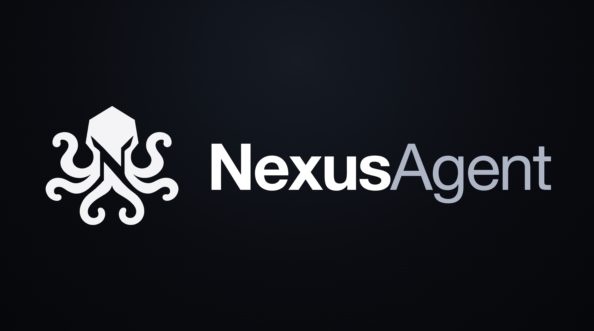
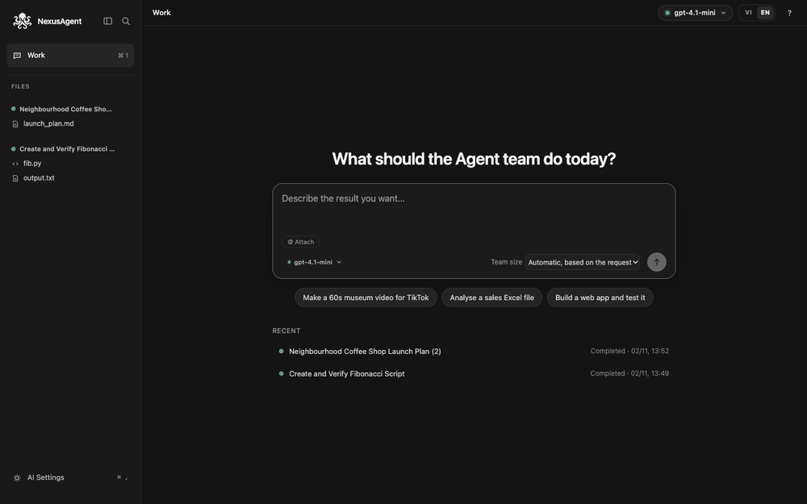
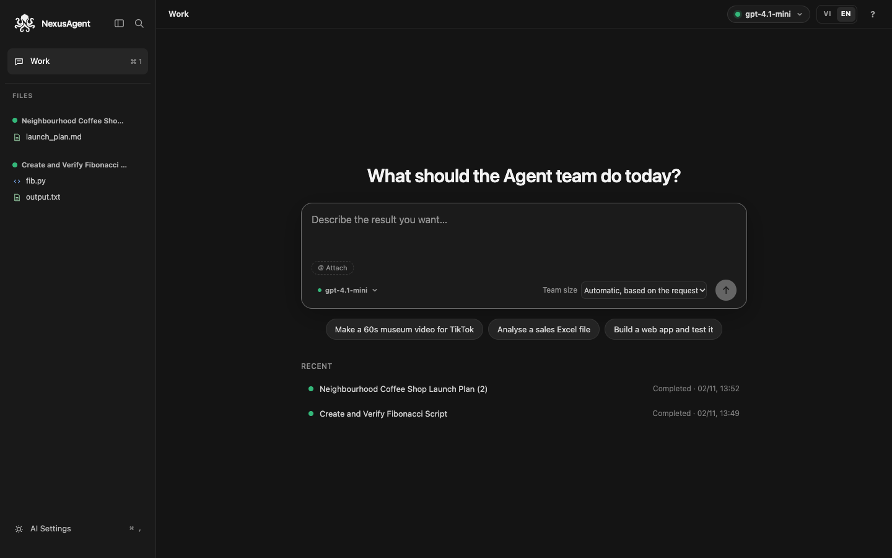
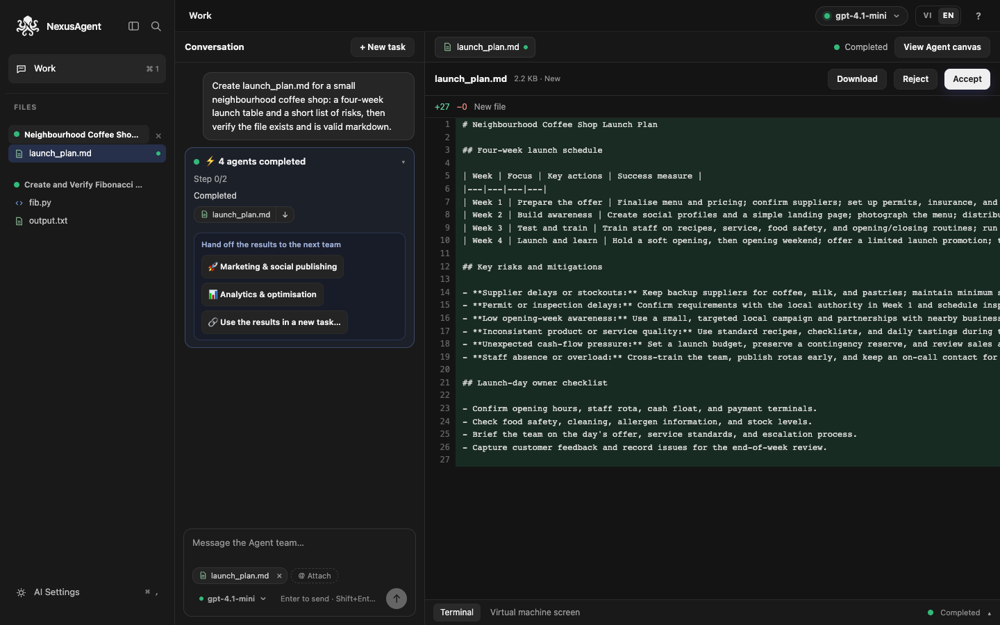
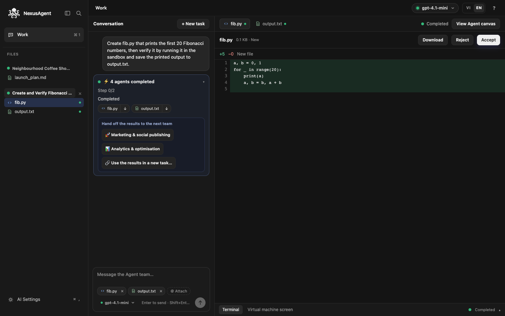
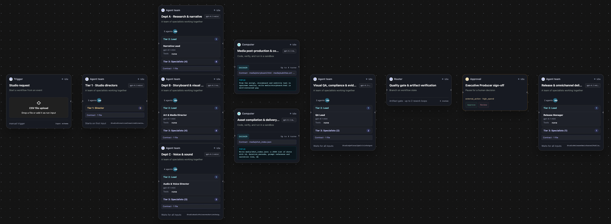
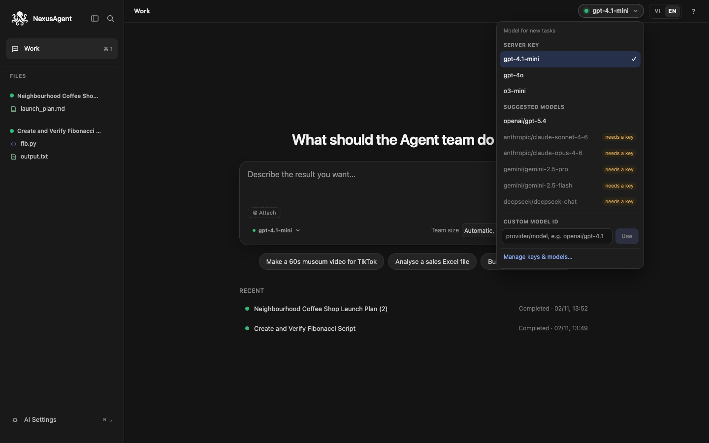
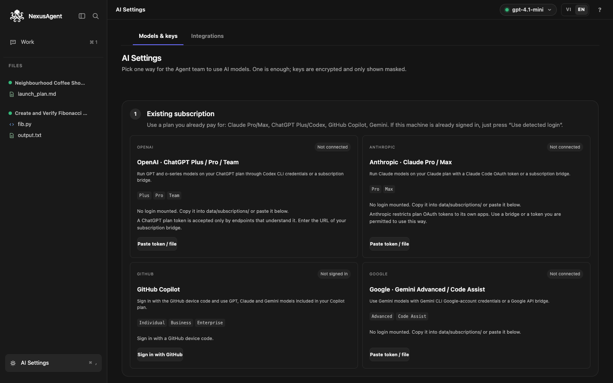
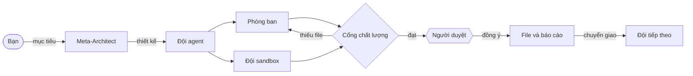
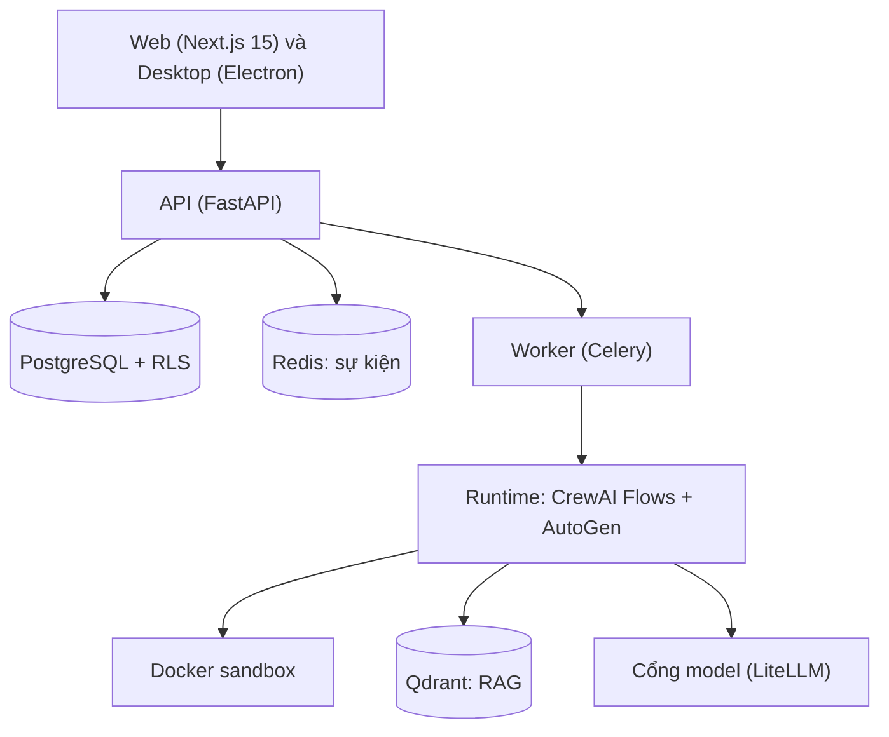

<p align="center">
  
</p>

<h3 align="center">Một đội AI có kiểm soát, chạy trong sandbox của chính bạn.<br>Nêu mục tiêu. Các agent lập kế hoạch, viết code và tạo file. Bạn duyệt những bước rủi ro.</h3>

<p align="center">
  <a href="README.md">English</a> · <b>Tiếng Việt</b>
</p>

<p align="center">
  <a href="https://github.com/khangkaka066/Nexus-Agent/actions/workflows/ci.yml"></a>
  <a href="LICENSE"></a>
  <a href="https://github.com/khangkaka066/Nexus-Agent/stargazers"></a>
  <a href="https://github.com/khangkaka066/Nexus-Agent/forks"></a>
  <a href="CONTRIBUTING.md"></a>
</p>

<p align="center">
  <a href="#-cài-đặt-nhanh">Cài đặt nhanh</a> ·
  <a href="#-giao-diện">Giao diện</a> ·
  <a href="#-bạn-nhận-được-gì">Tính năng</a> ·
  <a href="#-các-studio-agent">Studio agent</a> ·
  <a href="#-kết-nối-mô-hình">Mô hình</a> ·
  <a href="#-lộ-trình-và-giới-hạn">Lộ trình</a> ·
  <a href="CONTRIBUTING.md">Đóng góp</a>
</p>

---

## Vì sao có NexusAgent

Phần lớn dự án đa-agent chỉ là thư viện: bạn tự viết điều phối, sandbox, bước duyệt và giao diện. NexusAgent là sản phẩm hoàn chỉnh xây trên chúng. Đây là ứng dụng web và desktop tự lưu trữ: bạn gõ một mục tiêu, một AI kiến trúc sư thiết kế cả **đội** agent cho nó, đội chạy trong một máy tính Docker cô lập, và con người duyệt những bước nhạy cảm.

- **Một đội, không phải chatbot.** Yêu cầu thành đội có cấu trúc: giám đốc, trưởng phòng và chuyên viên, kèm cổng chất lượng trả phần thiếu về đúng phòng ban.
- **An toàn từ thiết kế.** Code chạy trong container bị siết quyền. Bước nhạy cảm dừng ở thẻ phê duyệt. Mọi quyết định ghi vào audit log.
- **Kết quả trung thực.** Đội khai báo một file mà không ghi sẽ thất bại với thông báo rõ (media không bao giờ bị bịa) thay vì "hoàn tất" giả.
- **Dùng model nào cũng được.** Gói ChatGPT, Claude, Gemini hay GitHub Copilot của bạn, API key, cổng tương thích OpenAI, hoặc model Ollama chạy trên máy.
- **Của bạn.** Tự lưu trữ, giấy phép MIT, không gửi telemetry ra ngoài.

---

## 🖼️ Giao diện

<p align="center">
  
</p>
<p align="center"><sub>Tham quan giao diện thật (các khung lấy từ ảnh chụp bên dưới).</sub></p>

<table>
  <tr>
    <td width="50%"><br><sub><b>Một ô nhập.</b> Mô tả kết quả; chọn model và quy mô đội.</sub></td>
    <td width="50%"><br><sub><b>Kết quả cạnh cuộc trò chuyện.</b> Xem, tải xuống, chuyển file cho đội tiếp theo.</sub></td>
  </tr>
  <tr>
    <td><br><sub><b>Code dạng diff.</b> Chấp nhận hoặc từ chối file vào thư mục dự án.</sub></td>
    <td><br><sub><b>Đội trên canvas.</b> Giám đốc, phòng ban, sandbox, cổng chất lượng, ký duyệt.</sub></td>
  </tr>
  <tr>
    <td><br><sub><b>Đổi model ngay.</b> Model đã kết nối, model phổ biến, hoặc nhập ID bất kỳ.</sub></td>
    <td><br><sub><b>Dùng gói bạn đang trả tiền.</b> Claude, ChatGPT, Copilot, Gemini hoặc API key.</sub></td>
  </tr>
</table>

---

## ⚡ Cài đặt nhanh

Cần Docker Compose, và một gói AI bạn đã dùng (ChatGPT, Claude, Gemini, GitHub Copilot) hoặc một API key.

```bash
git clone https://github.com/khangkaka066/Nexus-Agent.git && cd Nexus-Agent
cp .env.example .env
openssl rand -hex 32      # dán vào: NEXUS_POSTGRES_PASSWORD, NEXUS_RUNTIME_DB_PASSWORD,
                          #          NEXUS_REDIS_PASSWORD, NEXUS_SECRET_KEY, NEXUS_API_KEY_PEPPER
openssl rand -base64 32   # dán vào: NEXUS_CREDENTIAL_ENCRYPTION_KEY_BASE64
docker compose up -d --build
```

Mở **http://localhost:3000**. Chế độ local không cần đăng ký: *Local Workspace* được tạo sẵn. Sau đó:

1. **Cài đặt AI → Mô hình & khóa:** kết nối một model (xem [Kết nối mô hình](#-kết-nối-mô-hình)).
2. Gõ điều bạn muốn ở màn hình **Làm việc** rồi Enter.
3. Mở file đội tạo ra, tải xuống, hoặc chuyển cho một đội khác.

Trên Linux đặt `NEXUS_DOCKER_GID` theo group của `/var/run/docker.sock` và chạy `sudo chown -R 10001 data/artifacts` để container ghi được kết quả. API và `packages/` được mount với `--reload`; sau khi sửa code runtime hãy chạy `docker compose restart worker` (worker không tự nạp lại).

> **Chế độ local** (`NEXUS_LOCAL_MODE=true`, mặc định trong `docker-compose.yml`) cấp phiên chủ sở hữu cho bất kỳ ai truy cập được API. Chỉ dùng trên máy cá nhân; cổng web và API đã bind vào `127.0.0.1`. Trên máy chủ dùng chung hoặc công khai, đặt `NEXUS_LOCAL_MODE=false` để yêu cầu tài khoản.

---

## ✨ Bạn nhận được gì

| | Tính năng | Làm được gì |
|---|---|---|
| 🧠 | **AI Meta-Architect** | Biến một câu thành đội biên dịch được: agent, nhiệm vụ, công cụ, tri thức và cổng duyệt. |
| 🏢 | **Đội phân tầng** | Giám đốc, trưởng phòng, chuyên viên chạy song song, có hợp đồng sản phẩm và vòng làm lại. |
| 💻 | **Code sandbox** | Agent viết và kiểm tra code trong Docker (không mạng, bỏ capability, giới hạn tài nguyên) đến khi đạt. |
| ✅ | **Phê duyệt** | Bước nhạy cảm dừng ở thẻ *Allow once / Always allow / Deny*; mọi quyết định được ghi lại. |
| 🗂️ | **Lịch sử tác vụ** | Mỗi tác vụ và hội thoại được lưu; mở lại, xóa hoặc chạy lại. |
| 🩺 | **Lỗi dễ đọc** | Thẻ lỗi nêu phòng ban và agent dừng, lỗi đã lọc thông tin nhạy cảm. Chạy lại riêng bước lỗi (phòng ban xong được giữ) hoặc cả đội. |
| 🔗 | **Chuyển giao giữa các đội** | Đính kèm file của tác vụ trước bằng `@`, hoặc bấm *Hand off* để chạy đội marketing hay phân tích từ kết quả. |
| 🔌 | **Tự do model** | Gói đăng ký, API key, OpenRouter, Groq, Mistral, DeepSeek, Ollama, LM Studio, vLLM và cổng tương thích OpenAI; đổi model theo từng tác vụ. |
| 📚 | **RAG + MCP** | Tải tài liệu vào kho tri thức (Qdrant), hoặc nối máy chủ MCP và công cụ OpenAPI. |
| 🔁 | **Time travel** | Quay lại checkpoint bất kỳ, sửa trạng thái, chạy tiếp, hoặc tách hai nhánh để so sánh. |
| 🧬 | **Học và tiến hóa** | Agent chia sẻ bài học đã kiểm duyệt dưới tường lửa phạm vi; đội tự chẩn đoán điểm nghẽn, đề xuất thế hệ mới, có quay lui. |
| 💸 | **FinOps** | Theo dõi chi phí từng model, lượt dùng gói ghi $0, gợi ý model rẻ hơn khi chất lượng đã kiểm chứng. |
| 🛡️ | **Bảo mật đa-tenant** | Row-level security trên mọi bảng PostgreSQL, RBAC, API key có phạm vi, khóa được mã hóa. |
| 🌐 | **Tiếng Anh và tiếng Việt** | Đổi ngôn ngữ giao diện bất cứ lúc nào. |

---

## 🎬 Các studio agent

Yêu cầu một sản phẩm, NexusAgent dựng cả studio. Chọn quy mô: *gọn*, *theo phòng ban* (~19 agent) hoặc *toàn studio*.

| Studio | Agent | Tạo ra |
|---|---:|---|
| **Sản xuất phim điện ảnh và series** | 50 | Kịch bản, storyboard và previs, thiết kế và casting, quay phim, âm thanh, VFX, ngân sách và lịch quay, animatic, kế hoạch phát hành. |
| **Phát triển game** | 49 | Tài liệu thiết kế, định hướng nghệ thuật, code, kiểm tra build, bản xem thử. |
| **Marketing & đăng mạng xã hội** | 41 | Chiến lược, nội dung, gói riêng cho TikTok, YouTube, Facebook, lịch nội dung, bảng KPI, checklist ra mắt. |
| **Phân tích & tối ưu** | 34 | Kế hoạch đo lường, KPI nền từ dữ liệu bạn đính kèm, kế hoạch thử nghiệm, dự báo, báo cáo HTML. |
| **Nhà máy phần mềm SaaS & AI** | 32 | Kiến trúc, code backend và frontend, kiểm thử, rà soát bảo mật, ghi chú phát hành. |
| **Video & phim tài liệu** | 26 | Nghiên cứu, kịch bản, storyboard, kế hoạch giọng và âm thanh, phụ đề, contact sheet. |

Kèm bốn template nhỏ: Phân tích dữ liệu & tài chính, Kiểm thử & bảo mật phần mềm, Nghiên cứu thị trường & nội dung, và đồng đội điều hành hộp thư.

---

## 🏗️ Cách hoạt động





Runtime được lắp từ các plugin: kết nối, truy cập model, checkpoint, công cụ, và sandbox supervisor cùng provider Docker là những plugin độc lập do một kernel nhỏ gắn vào (`python -m nexus_plugins dump-config` in ra danh sách khi khởi động). Quy tắc nằm ở [AGENTS.md](AGENTS.md).

| Thư mục | Vai trò |
|---|---|
| `apps/web` | Giao diện Next.js |
| `apps/api` | API FastAPI, xác thực, thanh toán, worker |
| `apps/desktop` | Ứng dụng Electron, mount thư mục dự án |
| `packages/agent-runtime` | Biên dịch flow, crew, cầu AutoGen, time travel, consensus, plugin kernel |
| `packages/learning-transfer` | Knowledge capsule, tường lửa phạm vi, self-healing prompt |
| `packages/model-gateway` | Provider, connector gói đăng ký, giá, FinOps |
| `packages/computer-sandbox` | Sandbox Docker và cloud |
| `packages/rag-engine`, `mcp-hub`, `builtin-tools` | RAG, công cụ MCP và OpenAPI, công cụ dựng sẵn |
| `packages/core-schema` | Schema dùng chung và blueprint studio |

---

## 🔌 Kết nối mô hình

Vào **Cài đặt AI → Mô hình & khóa**.

| Nguồn | Cách làm |
|---|---|
| **GitHub Copilot** | Bấm *Sign in with GitHub* và nhập mã 8 ký tự. |
| **ChatGPT Plus / Pro / Team** | `codex login`, chép `~/.codex/auth.json` vào `data/subscriptions/codex/` (hoặc dán nội dung) và nhập URL cầu nối gói đăng ký. |
| **Claude Pro / Max** | `claude setup-token` rồi dán token, hoặc chép `~/.claude/.credentials.json` vào `data/subscriptions/claude/`. |
| **Gemini Advanced / Code Assist** | Chép `~/.gemini/oauth_creds.json` vào `data/subscriptions/gemini/`, hoặc dán token cầu nối. |
| **API key hoặc cổng** | **Nexus Harness**: nhập URL API và khóa của nhà cung cấp tương thích OpenAI, mô hình tự được lấy về. OpenAI, Anthropic, Gemini, DeepSeek, Ollama có thẻ riêng. |

Dùng bộ chọn model ở đầu trang (hoặc nút nhỏ trong ô nhập) để đổi model theo từng tác vụ, kể cả model bạn tự gõ ID. Lượt dùng gói được ghi $0 mỗi token, không cần bảng giá.

> Token gói chỉ chạy trên endpoint hiểu chúng (ví dụ cầu nối như CLIProxyAPI), và nhà cung cấp có thể giới hạn việc dùng token gói ngoài app chính chủ. Hãy kiểm tra điều khoản của gói bạn.

---

## 🖥️ Ứng dụng Desktop

[apps/desktop](apps/desktop/README.md) là vỏ Electron: mở thư mục dự án thật (`⌘/Ctrl+O`), xem thay đổi dạng diff, chấp nhận vào file của bạn, phím tắt toàn cục (`⌘/Ctrl+Shift+Space`) để giao việc nhanh, và thông báo hệ điều hành. `pnpm --filter @nexus/desktop dev` để chạy, `pnpm --filter @nexus/desktop build` để đóng gói. Bản `.dmg` trên macOS đã kiểm chứng; mục tiêu Windows và Linux đã cấu hình nhưng chưa thử.

---

## ⚙️ Cấu hình

| Nhóm | Biến |
|---|---|
| Bảo mật | `NEXUS_SECRET_KEY`, `NEXUS_API_KEY_PEPPER`, `NEXUS_CREDENTIAL_ENCRYPTION_KEY_BASE64` |
| Model | `NEXUS_*_API_KEY` (khóa máy chủ, tùy chọn), `NEXUS_MODEL_RATES_JSON` (ước tính chi phí, tùy chọn) |
| Gói đăng ký | `NEXUS_CODEX_HOME`, `NEXUS_CLAUDE_HOME`, `NEXUS_GEMINI_HOME`, `NEXUS_COPILOT_HOME` |
| Plugin | `NEXUS_PLUGINS_FILE`, `NEXUS_PLUGIN_PATCHES` |
| Truy cập | `NEXUS_LOCAL_MODE`, `NEXUS_PUBLIC_SIGNUP_ENABLED`, `NEXUS_REGISTRATION_TOKEN`, `NEXUS_CORS_ORIGINS` |
| Sandbox | `NEXUS_COMPUTER_ROOT`, `NEXUS_DOCKER_GID` |

Danh sách đầy đủ: [.env.example](.env.example). Gọi API bằng khóa có phạm vi: `curl -H "Authorization: Bearer nx-sk-<KEY>" http://localhost:8000/api/v1/workflows`.

---

## 🧪 Phát triển và kiểm thử

```bash
pytest && mypy packages/ apps/api/          # backend: hơn 180 test, kiểu chặt
pnpm lint && pnpm check && pnpm test        # frontend
python3 scripts/smoke_test.py               # toàn hệ thống (cần khóa model)
```

CI chạy cùng các lệnh này cộng kiểm tra giấy phép và thương hiệu ở mỗi lần push. Đọc [CONTRIBUTING.md](CONTRIBUTING.md) trước khi mở pull request.

---

## 🧭 Lộ trình và giới hạn

- **Chưa đăng thật lên TikTok, Facebook, YouTube.** Đội marketing và đội phim soạn gói đăng và checklist sẵn rồi dừng chờ bạn duyệt; thẻ kênh chỉ lưu token và kiểm tra kết nối.
- **Tạo video** phụ thuộc nhà cung cấp của bạn có API video. Agent mô tả, lập kế hoạch và ghép media; chúng không bịa file.
- Giao diện hiện có một workspace local; bộ chuyển workspace nằm trong kế hoạch (backend đã cô lập workspace).
- Agent vẫn có thể đánh giá sai việc của mình. Khai báo sai được phát hiện và báo lại, mọi lần chạy đều có thể chạy lại, nhưng hãy tự xem lại sản phẩm quan trọng.
- Dự kiến: node handler thành plugin, cấu hình plugin theo workspace, kiểm chứng desktop trên Windows và Linux.

Ý tưởng và báo lỗi xin gửi ở [Issues](https://github.com/khangkaka066/Nexus-Agent/issues).

---

## ⭐ Ủng hộ dự án

Nếu NexusAgent giúp bạn tiết kiệm thời gian, một ngôi sao giúp người khác tìm thấy dự án, và chia sẻ ảnh chụp đội bạn dựng được còn giúp nhiều hơn.

<a href="https://star-history.com/#khangkaka066/Nexus-Agent&Date">
  
</a>

## 🔒 Bảo mật và giấy phép

- Cô lập theo tenant và workspace ở PostgreSQL, Qdrant, Redis và sandbox. Báo lỗ hổng riêng tư: xem [SECURITY.md](SECURITY.md).
- Không gửi telemetry ra ngoài.
- Chỉ dùng dependency giấy phép cho phép thương mại (kiểm bằng CI); xem [THIRD_PARTY_NOTICES.md](THIRD_PARTY_NOTICES.md).
- Phát hành theo [giấy phép MIT](LICENSE).
